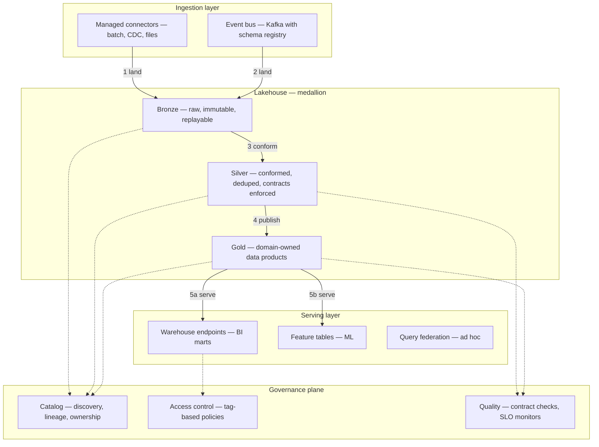
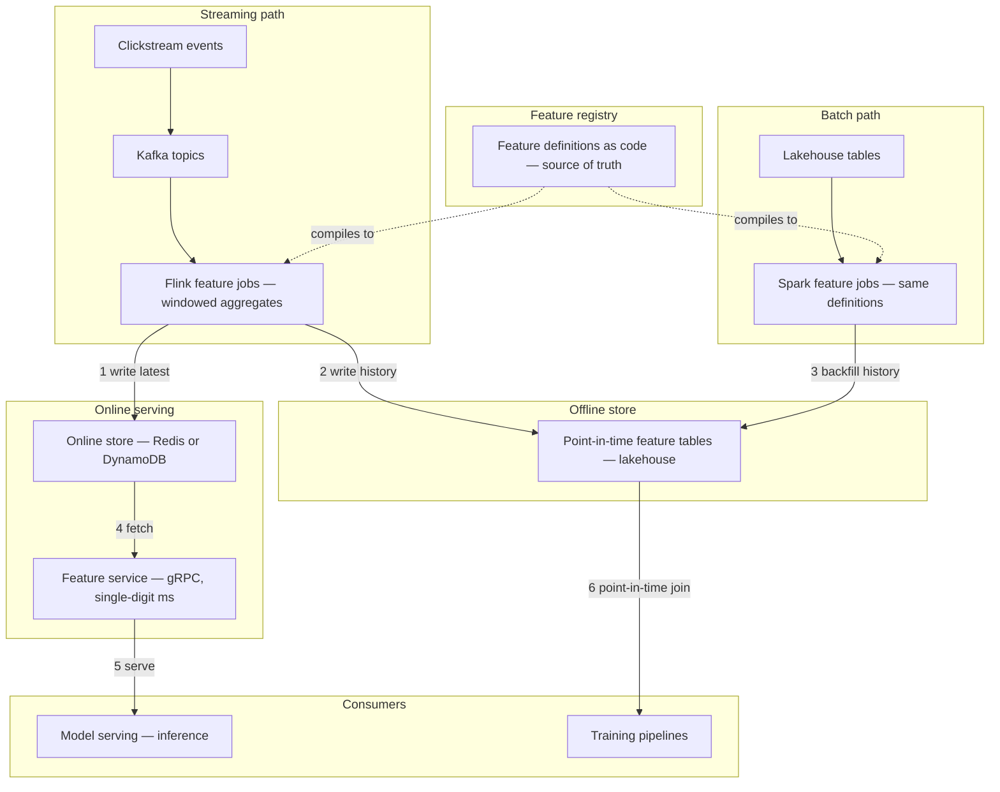
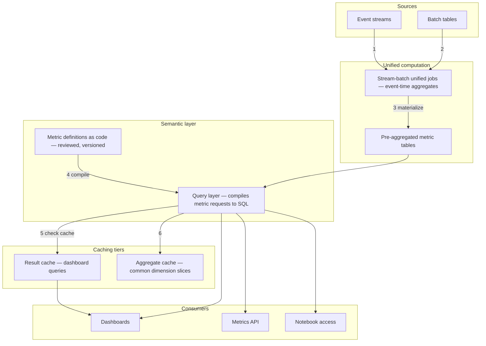
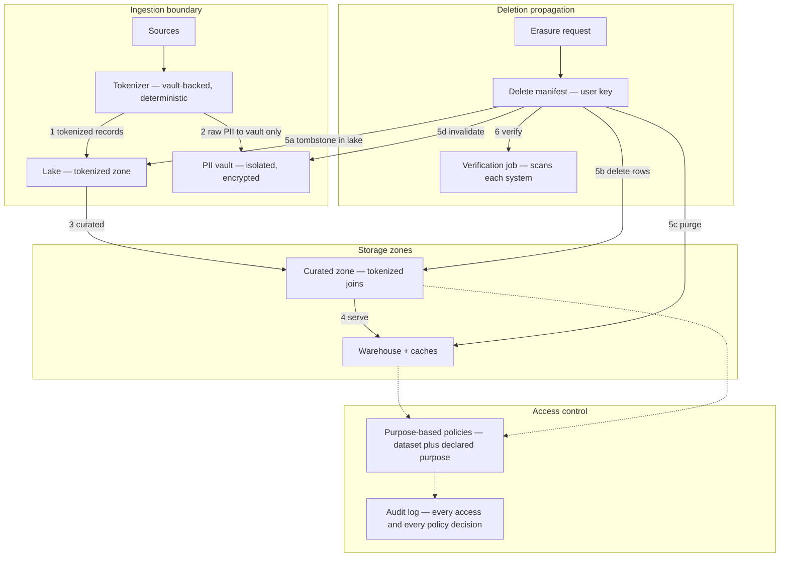
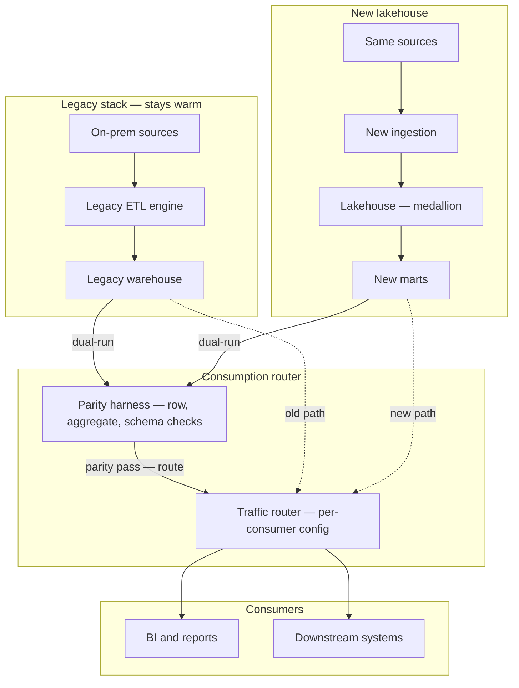
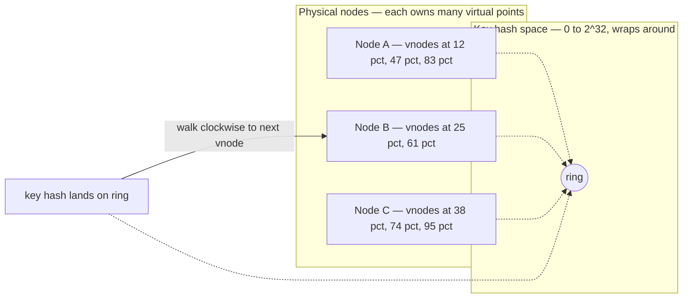
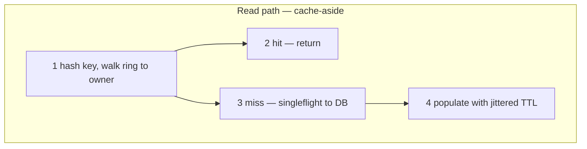
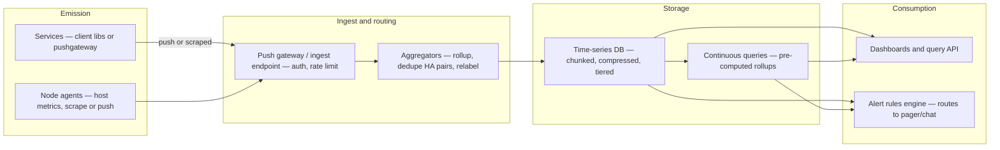
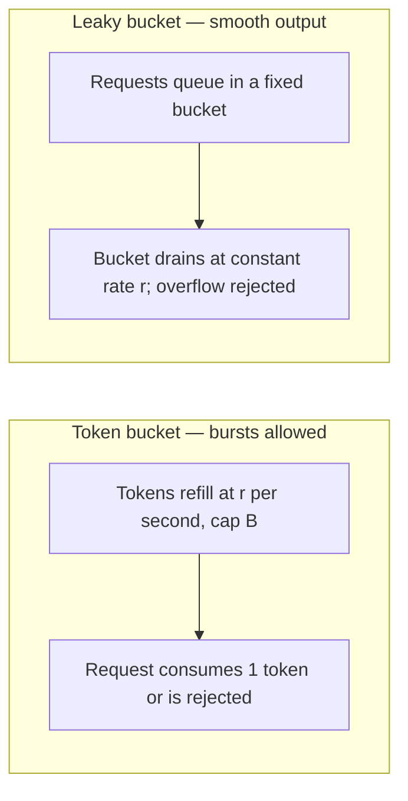
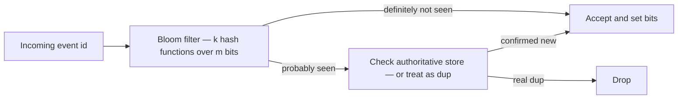

# Data Platform Design Case Studies

> **Why it matters** — "Design the data platform" is the senior/staff interview prompt that separates people who have built one from people who have only used one. These five case studies practice the full arc — requirements, layered architecture, capacity math, decision log, failure modes, and what breaks at 10x — on the designs you will actually be asked for.

Each case follows the same skeleton — the same skeleton a strong interview answer follows:

1. **Requirements** — functional plus non-functional, with the numbers that drive the design.
2. **Architecture** — layered diagram, numbered data flow.
3. **Capacity estimate** — five lines of arithmetic, narrating which number drives the design.
4. **Decision log** — the trade-offs you chose and why, not the tools you chose.
5. **Failure modes** — what breaks and the mitigation pattern.
6. **At 10x** — which assumption dies first.

The pattern vocabulary underneath every case lives in [Designing Reliable Pipelines](/system-design/pipeline-design) — idempotency, DLQs, contracts, SLOs. Storage and format choices are covered in [Lakehouse Platforms](/cloud/lakehouse-platforms). This chapter applies them, it does not reteach them.

::: tip 💡 Senior insight
In a platform-design interview, the deliverable is not a diagram — it is the *decision log*. Interviewers probe "why not the alternative?" five times more often than "what does this box do?" Sketch fast, argue trade-offs slowly.
:::

## Case 1 — Greenfield lakehouse for a 50-team org

**The ask.** A company with ~50 product teams, five legacy data silos, and no shared platform wants a lakehouse: batch + stream ingestion, governed data products, self-service analytics, and ML feature reuse — without creating a 40-person central bottleneck.

| Requirement | Design implication |
|---|---|
| 50 teams onboard in 12 months | Self-service is the product — templates, paved paths, guardrails over gates |
| Batch + stream sources | One ingestion framework with two runtimes, not two stacks |
| Regulated + unregulated data coexist | Governance and classification in the platform, not per team |
| BI and ML consumers | Two serving surfaces: governed marts for BI, feature tables for ML |
| Central team of ~8 | Platform team owns primitives; product teams own data products — data mesh-lite |

1. Connectors and producers land data into **bronze** — immutable, partitioned by arrival, replayable.
2. Stream events route through the bus with registry-enforced schemas; bad events DLQ at the boundary.
3. Bronze→silver conformance runs as platform-templated jobs: dedupe, contract validation, PII tagging.
4. Silver→gold is **domain-owned**: each product team publishes gold tables with an owner, SLO, and catalog entry — the mesh-lite contract.
5. Serving splits: BI hits governed marts via warehouse endpoints; ML reads feature tables; ad hoc goes through federation with scan quotas.

### Capacity estimate

- **Ingestion**: 200 sources × ~5 GB/day avg ≈ **1 TB/day landed**; streams add ~2k events/s sustained — trivial for a 6-12 partition bus.
- **Storage**: 1 TB/day × 365 × ~2.5x replication-and-layer overhead ≈ **~1 PB/year** across medallion layers; Parquet compression cuts raw landing ~4x.
- **Compute driver**: not ingest — it is *concurrency*. 50 teams × ad hoc analysts is where warehouse costs spike; quotas and autosuspend matter more than cluster size.
- **Team math**: 8 platform engineers can support ~50 teams only if onboarding is self-service; at >10 tickets/team for onboarding, the platform team becomes the bottleneck — measure onboarding lead time as the platform SLO.

### Decision log

| Decision | Options | Call | Why |
|---|---|---|---|
| Ownership model | Central DE team vs full mesh vs mesh-lite | **Mesh-lite** — central primitives, domain-owned gold | Full mesh needs platform maturity the org lacks; pure central does not scale past ~15 teams |
| Table format | Delta vs Iceberg vs Hudi | **Iceberg** | Multi-engine support, no vendor lock on the catalog |
| Catalog | Open-source vs cloud-native | Cloud-native with open API | 8-person team should not run a metastore |
| Compute | Spark everywhere vs SQL-first warehouse | SQL-first, Spark for heavy transforms | Analysts outnumber engineers 10:1 |

### Failure modes

| Failure | Mitigation |
|---|---|
| Team publishes gold with no owner or SLO | Catalog enforces registration on publish; unregistered tables get read-only then archived |
| A team's silver job corrupts shared bronze | Bronze is append-only and platform-owned — domain jobs are read-only on bronze |
| Self-service sprawl — 500 tables nobody owns | Ownership TTL: tables without an active owner emit warnings, then get de-listed |
| One team's runaway query starves the warehouse | Workload isolation + per-team scan quotas |

### What changes at 10x

- **500 teams**: the catalog becomes the bottleneck — discovery, lineage depth, and policy evaluation. You need domain-level namespaces and delegated stewardship, not a flat catalog.
- **10 TB/day**: bronze-to-silver conformance cost dominates; move to incremental/micro-batch reads and drop full-scan jobs.
- **Governance**: manual stewardship review dies at ~100 products; automate classification and policy-as-code.

::: warning ⚠️ Risk / production failure mode
The most common failure of this design is organizational, not technical: the platform team keeps owning gold "temporarily" because domains are not ready. Six months later the central team owns 200 pipelines and the mesh never happens. Set the ownership-transfer deadline in the platform charter, not per team.
:::

## Case 2 — Real-time personalization and feature platform

**The ask.** Events from web + mobile feed a personalization model that must serve features in single-digit milliseconds, while the *same* features train the model offline — without training-serving skew.

| Requirement | Design implication |
|---|---|
| p99 feature fetch under 10 ms | Online store must be a KV lookup, not a query |
| Same feature logic for train and serve | One feature definition compiled to both paths |
| Features must be point-in-time correct | Training set built via point-in-time joins, not "latest values" |
| 100k feature fetches/s peak | Online store sized for reads, not writes |
| New features weekly | Feature registry as code with CI validation |

1. Flink consumes events and maintains windowed feature state.
2. Latest feature values write to the online store keyed by entity; full history lands in the offline store.
3. Batch jobs compute the *same* feature definitions over lakehouse history — the registry generates both jobs from one definition.
4. At inference, the feature service does one KV lookup per entity — no computation in the hot path.
5. Training pulls features via **point-in-time joins**: for each labeled event, the feature value *as of* that event time — never the latest value.

### Capacity estimate

- **Event rate**: 50k events/s peak → ~3-5 Flink tasks per feature group with checkpointed state; state size driven by window × cardinality, not rate.
- **Online store**: 10M entities × ~2 KB feature vector ≈ **20 GB** — fits in a modest Redis cluster; 100k reads/s × small values is comfortably within DynamoDB on-demand or a 3-shard Redis.
- **Latency budget**: p99 = network 1-2 ms + KV lookup 1-3 ms + serialization ~1 ms → headroom inside 10 ms only if *nothing computes* on read. Any per-request aggregation blows the budget.
- **Offline**: point-in-time joins over 90 days of features is the expensive operation — a 1M-label training set joining 50 features scans terabytes; partition pruning by label-date is mandatory.

### Decision log

| Decision | Options | Call | Why |
|---|---|---|---|
| Online store | Redis vs DynamoDB vs purpose-built KV | Redis if sub-5ms p99 required, DynamoDB if ops simplicity wins | Redis wins latency, loses on managed ops — pick per p99 target |
| Feature parity | Dual implementations vs one definition, two compilers | **One definition, two engines** | Dual implementations *will* drift; the registry is the whole point |
| Point-in-time correctness | As-of join at training time vs snapshot tables | As-of joins on event-time partitioned features | Snapshots explode storage; event-time partitions make as-of joins cheap |
| Freshness | Full streaming vs hybrid | **Hybrid** — stream for recency features, batch for lifetime aggregates | Streaming everything is 5-10x cost for features that do not need it |

### Failure modes

| Failure | Mitigation |
|---|---|
| Training-serving skew — different logic in the two paths | Single registry definition; CI check compares online vs offline values on a sampled entity set |
| Feature service returns stale or missing features | TTL per feature + null-default contract; monitor serving-vs-offline freshness drift |
| Late events corrupt a windowed feature | Event-time semantics + allowed-lateness watermark; corrections write a new version, never mutate served values silently |
| Online store hot-keyed by celebrity entities | Key-level load shedding; cache hot entities at the feature-service layer |

### What changes at 10x

- **1M fetches/s**: the feature service tier — not the store — becomes the bottleneck; add entity-level caching and connection pooling before scaling the KV.
- **1000s of features**: registry CI and parity sampling become the slow path; you need feature lineage to prune unused definitions.
- **Cross-region**: online store replication lag causes regional skew — decide per feature whether regional consistency or global freshness wins.

::: details Point-in-time correctness — the detail interviews probe
If your training set uses "current" feature values, you train on the answer — leakage. A model trained on post-event features looks great offline and fails in production. The fix is always the same: features stored with event-time validity, training sets materialized with as-of joins keyed on label timestamp. This is the single most-tested concept in feature-platform design — name it before being asked.
:::

## Case 3 — Global metrics and semantic layer

**The ask.** Fifty dashboards disagree on "revenue." Build one metrics platform: definitions-as-code, one computation path for dashboards and APIs, fast enough for interactive BI.

| Requirement | Design implication |
|---|---|
| One definition per metric, org-wide | Metrics-as-code in a repo, code-reviewed like application code |
| Dashboards, APIs, embedded analytics | Metrics served through one query layer, not per-tool logic |
| Interactive latency under 2 s | Pre-aggregation and caching tiers, not raw scans |
| Stream + batch sources | Unified pipeline — no lambda architecture maintaining two logic paths |
| Self-serve new metrics | Declarative metric definitions with guardrails, not free SQL |

1. Events and batch sources feed **one** computation layer — event-time aggregates that work identically on stream and historical data.
2. Metric definitions live as code: `metric: weekly_active_users, agg: count_distinct, entity: user_id, window: 7d` — reviewed, versioned, compiled.
3. The query layer resolves a metric + dimensions + filters into optimized SQL against pre-aggregated tables.
4. Two cache tiers: raw result cache for repeat dashboard queries, and a shared aggregate cache for common dimension slices.
5. Every consumer — BI, API, notebooks — resolves through the same layer, so "revenue" cannot diverge by tool.

### Capacity estimate

- **Traffic**: 5k daily dashboard users × 20 queries ≈ 100k metric queries/day — small. The driver is **unique query shapes**: 50 metrics × 20 dimensions × time grains ≈ combinatorial materialization space.
- **Pre-aggregation**: a fact table at 1 TB/day rolls up to ~10-50 GB/day at the common grain — a 20-100x scan reduction; materialization cost amortizes after ~5-10 reads per aggregate.
- **Cache hit rate**: dashboards refresh identically — 80-90% result-cache hit rate is normal; the remaining 10-20% of unique shapes are where the platform spends money.
- **Freshness cost curve**: 15-minute freshness ≈ 1.5-2x the cost of hourly; sub-minute ≈ 5-10x. Price it, then negotiate.

### Decision log

| Decision | Options | Call | Why |
|---|---|---|---|
| Where metrics live | In BI tool vs dbt models vs dedicated semantic layer | **Dedicated layer** — BI tools come and go | Metric logic in Looker/dbt is trapped logic; the layer outlives the tool |
| Lambda vs unified | Separate stream and batch pipelines vs one event-time framework | **Unified** | Two code paths always produce two answers; the whole problem is one answer |
| Pre-aggregation | Always-on vs on-demand materialization | On-demand with a promotion rule | Materializing every combination is waste; promote aggregates after N reads |
| Metric change rollout | Immediate vs versioned | **Versioned with a canary window** | A metric redefinition silently changes every dashboard — roll it out like a deploy |

### Failure modes

| Failure | Mitigation |
|---|---|
| Two tools compute "revenue" differently | Force all reads through the query layer; block direct fact-table access for served metrics |
| Pre-aggregate drift from source | Reconciliation job: nightly full-scan comparison vs aggregates, alert on divergence |
| Metric definition change silently alters dashboards | Definitions are versioned; changes emit a diff report and require consumer ack for breaking changes |
| Cache serves stale results past freshness SLO | Cache TTL tied to data freshness watermark, not a fixed clock TTL |

### What changes at 10x

- **10k+ metrics**: discovery and deduplication become the problem — the platform needs metric lineage and "does this already exist?" search, or teams re-declare the same metric five ways.
- **1M queries/day**: the query layer itself needs horizontal scaling and per-consumer quotas.
- **Sub-minute freshness demands**: the unified layer's micro-batch cadence becomes cost-dominant; tier freshness per metric — the CEO dashboard and a debug metric should not share a freshness class.

::: tip 💡 Senior insight
The semantic layer's hardest problem is not SQL generation — it is *organizational adoption*. If teams can still query the raw fact table, they will. The platform wins when the governed path is also the *easiest* path — that is a product decision, not an architecture one.
:::

## Case 4 — Compliance-grade PII platform

**The ask.** GDPR/CCPA apply. Design ingestion where PII is tokenized at the boundary, access is purpose-scoped, and a deletion request provably removes a user from lake, warehouse, and caches.

| Requirement | Design implication |
|---|---|
| PII never raw in the lake | Tokenize at ingest — raw PII lives only in a vault |
| Purpose-based access | Access decisions on "why," not just "who" — policy per dataset-purpose pair |
| Right to erasure across all systems | Tombstone propagation with a verifiable delete manifest |
| Audit everything | Immutable lineage and access log, itself queryable |
| Analytics still works on tokenized data | Deterministic tokens preserve joinability without revealing identity |

1. All records pass through the tokenizer; raw PII fields are replaced with deterministic tokens — the same person always gets the same token, so joins still work.
2. Raw PII exists only in an isolated vault with its own access path and its own, stricter, audit trail.
3-4. All downstream systems — curated lake, warehouse, caches — contain only tokenized data; a breach of the analytics zone is not a PII breach.
5. Erasure: a delete manifest drives tombstones in the lake, row deletes in curated zones, cache invalidation, and vault invalidation of the token→PII mapping.
6. A verification job scans each system and attests completion — "we believe we deleted" is not compliance.

### Capacity estimate

- **Tokenizer throughput**: 50k records/s × ~200 μs/lookup = trivially within a small autoscaled service; the vault write is the latency driver — batch PII writes, stream tokens.
- **Deletion volume**: assume ~0.1% of a 50M-user base per month ≈ 50k erasures/month — a per-user-row scan over petabytes is infeasible; you need **partition pruning by user cohort** or a maintained key→partition index.
- **Storage overhead**: token adds ~16-32 B/row — negligible. The real cost is the *second* copy of every PII join path: vault + tokenized.
- **Audit log**: every query + policy decision logged → ~10-100M rows/day; this log is itself a data platform with retention and query needs.

### Decision log

| Decision | Options | Call | Why |
|---|---|---|---|
| Tokenization vs encryption at rest | Tokenize at boundary vs encrypt columns | **Tokenize** | Encryption still leaves PII readable wherever it is decrypted; tokens make the analytics zone PII-free by construction |
| Delete strategy | In-place deletes vs tombstone + rewrite | **Tombstone manifest + scheduled partition rewrite** | In-place deletes on a lake are partial and unverifiable; tombstones are replayable and auditable |
| Vault access | Detokenization service vs direct vault queries | Detokenization service with purpose check | Every identity resolution is a policy decision — centralize it or lose it |
| Access model | RBAC vs purpose-based ABAC | **Purpose-based** | GDPR is about purpose, not roles; "analyst" is not a purpose |

### Failure modes

| Failure | Mitigation |
|---|---|
| A pipeline lands raw PII by bypassing the tokenizer | Boundary is enforced at the connector layer — no write path exists that skips tokenization; scanners audit the lake for PII patterns anyway |
| Delete manifest misses a system | The manifest is generated from *lineage* — systems not in lineage cannot hold the user's data in the first place |
| Cache retains a deleted user past SLA | Deletion includes explicit cache invalidation keys; verification job re-checks caches at T+SLA |
| Token collision or re-identification via join | Tokens are vaulted and rotating per purpose; cross-purpose joining requires the detokenization service — which logs it |
| Vault itself is breached | Vault is isolated, minimal-retention, and access is purpose-gated with human review for bulk detokenization |

### What changes at 10x

- **10x erasure volume**: per-request scanning dies — you need a precomputed key→location index so deletion is a lookup, not a scan.
- **Multi-region**: data residency adds a placement dimension — "delete EU user" must know which regions legally held the data; lineage gains a region tag.
- **More regulations**: retention rules diverge per jurisdiction — the manifest becomes a per-purpose, per-region policy evaluation, not one delete list.

::: warning ⚠️ Risk / production failure mode
The silent failure of this design is *shadow copies*: exports, notebook checkpoints, local parquet files, model training snapshots. They bypass every control above. Compliance platforms fail audits on data that left the platform, not data inside it. The mitigation is export governance — approved extract paths only — which is the least technical and most ignored part of the design.
:::

## Case 5 — Legacy on-prem ETL to cloud lakehouse migration

**The ask.** A 10-year-old Informatica/on-prem stack with 3,000 jobs migrates to a cloud lakehouse. Zero downtime, provable parity, and a rollback story — the strangler-fig pattern.

| Requirement | Design implication |
|---|---|
| Zero business disruption | Run old and new in parallel; cut over per pipeline, not big bang |
| 3,000 legacy jobs | Migration is a *program* — inventory, prioritize, automate |
| Numbers must match | Dual-run parity framework with per-table gates |
| Some pipelines can't move | Hybrid coexistence is a long phase, not an edge case |
| Rollback must be real | Old stack stays warm until a pipeline proves itself in prod |

1. **Inventory first**: classify all 3,000 jobs by consumer criticality, complexity, and data volume — the migration order is a portfolio decision (high-value, low-complexity first).
2. Each migrated pipeline runs in **dual-run**: the new lakehouse path produces output alongside the legacy output.
3. The **parity harness** compares: row counts, aggregate checksums, schema, and sampled row-level values — per table, per run.
4. The **router** sends consumers to legacy by default; a pipeline flips to the new path only after passing its parity gate for a defined window (e.g., 7 consecutive daily runs).
5. Legacy decommissions per-pipeline only after the new path has run in prod — not just in parity — for a soak period.

### Capacity estimate

- **Timeline driver**: not compute — it's parity iteration. Assume ~30% of pipelines fail first parity for semantic (not technical) reasons; budget 2-3 parity cycles per pipeline.
- **Dual-run cost**: you pay 2x compute during migration — for a 12-month program that's the largest single line item. Scope dual-run to the *serving* layer only where possible (compare marts, not every intermediate).
- **Job triage math**: 3,000 jobs ÷ ~20 pipelines/week throughput for a 6-person migration team ≈ 12-18 months — if throughput is lower, the program needs more parallelism, not more time pressure.
- **Rollback cost**: keeping the old stack warm ≈ 60-80% of its run cost — factor this into the migration business case, not as an afterthought.

### Decision log

| Decision | Options | Call | Why |
|---|---|---|---|
| Migration pattern | Big bang vs strangler-fig vs rewrite-first | **Strangler-fig** | Big bang on 3,000 jobs is a resume-generating event |
| Parity bar | Exact match vs tolerance bands | **Exact on keys and counts; tolerance on floats and timestamps** | Legacy systems have latent bugs — 100% exact parity sometimes means re-implementing the bug |
| Order | Easy-first vs value-first vs dependency-first | **Value × risk matrix** — high value, low dependency first | Easy-first burns a year on jobs nobody reads |
| Semantic drift | Replicate legacy bug vs fix in new | Fix in new, flag as *known parity exception* | Documented divergence beats replicated bug — but it must be a decision, not a surprise |

### Failure modes

| Failure | Mitigation |
|---|---|
| Parity shows mismatch nobody can explain | Classify: schema drift, filter bug, late-arriving data, or legacy bug — each class has a different fix, and "unknown" blocks cutover |
| A pipeline passes parity but breaks under real load | Parity compares data, not performance — add a load soak to the cutover gate |
| Consumers hit the new path silently before it's ready | Router is the only access path; direct connections to the new marts are blocked until flip |
| The last 10% of jobs never migrate | They are usually the ones with hidden consumers — freeze the legacy stack to read-only, log actual reads, and let usage data prove which jobs are truly dead |
| Migration stalls at 60% | Strangler programs die of organizational attention loss — a weekly burn-down of remaining pipelines, owned by leadership, is the mitigation |

### What changes at 10x

- **30,000 jobs**: manual migration dies — you need transpiler automation for the mechanical 70% and humans only for the semantic 30%.
- **Cross-region cutover**: the router becomes multi-region traffic management; parity must account for replication lag, not just correctness.
- **The platform itself migrates**: the new lakehouse will one day be the legacy — build the *parity harness and router as permanent platform primitives*, not migration scaffolding.

::: details The parity gate is the entire migration
Everything else in this design is detail. The migration is "safe" precisely to the degree the parity harness is trustworthy — a parity framework that misses semantic drift gives false confidence, which is worse than no check. Interviews probe this: "how do you know parity is right?" Answer: run the harness on the legacy system against itself first — if it can't prove identity, it can't prove parity.
:::

## Case 6 — Consistent-hashing cache tier in front of a hot serving layer

**The ask.** A serving layer reads user-facing aggregates — profiles, balances, rankings — at 200k reads/s, and 70% of that traffic hits the same 5% of keys. The backing store is fast but expensive at that concurrency. Design a distributed cache tier that scales horizontally, survives node loss without mass key movement, and absorbs the hot-key tail.

| Requirement | Design implication |
|---|---|
| Nodes join/leave weekly | Consistent hashing — only ~1/N of keys move per membership change, vs ~all keys under `hash % N` |
| Skewed node sizes and uneven spread | Virtual nodes — each physical node owns ~100+ points on the ring, smoothing load to a few % |
| Hot keys dominate reads | Hot-key mitigation beyond the ring — replication of hot keys, no-TTL pins, local in-process L1 |
| Cache miss must not stampede the DB | Cache-aside with request coalescing and jittered TTLs |
| Writes must not leave stale reads | Short TTLs + explicit invalidation on write; write-through only where staleness is intolerable |

1. Each physical node registers ~100-150 **virtual nodes** on the ring; a key's owner is the first vnode clockwise from `hash(key)`.
2. A node failure shifts only the arcs adjacent to its vnodes — spread across all surviving nodes, not one neighbor.
3. Reads are **cache-aside**: check cache, miss → fetch DB, populate, return. A singleflight/lease per key ensures one concurrent DB fill per key, not 10k.
4. TTLs get ±10-20% jitter so a bulk-warmed tier does not expire in unison (thunder herd).
5. The top hot keys are detected by access counters, then replicated to every node or pinned with no TTL and refreshed asynchronously — the hot-key tail, not the ring, is what actually saturates nodes.

### Capacity estimate

- **Working set**: 500M keys × ~1 KB ≈ **500 GB** — fits comfortably on 8-10 cache nodes at 64-96 GB each, leaving headroom for vnode rebalancing.
- **Traffic**: 200k reads/s; at a 95% hit rate the DB sees ~10k/s — the tier's job is to keep misses below the DB's comfort zone, not to reach 100%.
- **Hot key math**: if one key takes 5% of reads, that is **10k reads/s on one vnode owner** — a single node's ceiling. Hot-key replication to all nodes divides that by N.
- **Rebalance cost**: adding a node moves ~1/(N+1) of the keyspace; with 10 nodes, ~9% of keys re-home — cheap. Under `hash % N`, adding a node re-homes ~90%.

### Decision log

| Decision | Options | Call | Why |
|---|---|---|---|
| Read pattern | Cache-aside vs read-through vs refresh-ahead | **Cache-aside + singleflight** | Read-through couples app to cache client logic; refresh-ahead wastes writes on cold keys |
| Write pattern | Write-through vs write-around vs write-back | **Write-around + invalidate** | Writes are rare and reads dominate; write-back risks loss, write-through adds write latency the path does not need |
| Hot keys | More vnodes vs dedicated replicas vs local L1 | **Replicate to all nodes + short in-process L1** | Vnodes smooth *average* load but cannot fix a single-key ceiling — only fan-out fixes that |
| Membership metadata | Gossip ring vs coordinator-managed | Coordinator-managed ring map | Gossip converges slowly; a wrong ring map routes misses to dead nodes — correctness of the map beats decentralization here |

### Failure modes

| Failure | Mitigation |
|---|---|
| Mass TTL expiry stampede (thunder herd) | Jittered TTLs; on miss, a per-key lease lets exactly one request fill while others wait or serve stale |
| Hot key expires mid-spike (cache breakdown) | Top-N keys get no TTL + background async refresh — the 80/20 keys never expire on a clock |
| Requests for nonexistent keys hammer the DB (cache penetration) | Cache null results with short TTL, or front the tier with a Bloom filter for "definitely absent" keys |
| Whole tier down (cache crash) | Circuit breaker at the client + multi-AZ cache nodes; the DB must survive a brown-out anyway — never let the cache be a hidden single point of load |
| Stale reads after write | Version-stamped keys or explicit delete-on-write; where staleness is intolerable, that slice gets write-through or bypasses the tier |

### What changes at 10x

- **2M reads/s**: client-side request routing needs the ring map pushed to clients (smart clients) — proxying every read through a routing tier adds a hop and a bottleneck.
- **Hot-key churn**: at this scale the top keys rotate hourly; static pinning dies — hot-key detection becomes a small continuous stream job (count-min sketch over access logs) feeding a replication set.
- **Multi-region**: a single ring per region, not a global ring — cross-region key ownership turns a cache lookup into a WAN call.

## Case 7 — Metrics and monitoring pipeline

**The ask.** The platform is 300 services emitting metrics. Engineers need dashboards, SLO burn alerts, and the ability to slice any metric by service, endpoint, and region — without one team's debug label taking down the monitoring backend.

| Requirement | Design implication |
|---|---|
| 300 services, per-second granularity | Push from agents into a horizontally scalable ingest tier; storage is a time-series engine, not a general database |
| Arbitrary labels per metric | Cardinality is *the* capacity problem — bound label space at emit time |
| Alerts on SLOs, not just thresholds | A rules tier evaluating recorded queries over the same store, so alert math matches dashboard math |
| Bursty failure modes | The monitoring pipeline must be *more* reliable than what it monitors — isolated infra, buffered agents |

1. Services and node agents emit metrics — either **pulled** (a scraper fetches `/metrics`) or **pushed** (agents POST to an ingest endpoint).
2. The ingest tier authenticates, rate-limits per emitter, and normalizes labels — this is where a rogue emitter is contained.
3. Aggregators dedupe HA scraper pairs and compute rollups (sum by service, drop high-cardinality labels) before storage.
4. The time-series store chunks by time, compresses run-length/delta, and tiers: raw for days, 1-minute rollups for months, 1-hour for a year.
5. Dashboards and the alert engine query the same store and the same rollup tables — alert math and chart math can never diverge.

### Capacity estimate

- **Series count**: 300 services × ~200 metrics × ~50 label combos ≈ **3M active series** — fine. The same metrics with `user_id` or `request_id` as a label ≈ billions of series — dead. Cardinality, not samples, is the bill.
- **Samples**: 3M series at 15s scrape ≈ 200k samples/s — a mid-size time-series cluster; compressed at ~1-2 bytes/sample ≈ **~15-30 GB/day**.
- **Query load**: dashboards poll on refresh; 500 dashboard users × 10 panels × 30s refresh ≈ ~1.7k queries/min — trivial. Alert evaluation is the steady query load: ~2k rules × 1/min.
- **Retention math**: raw 30d + 1m rollup 400d + 1h rollup 3y cuts storage ~20x vs raw-everything; rollups also cut query time by pre-answering the common grain.

### Pull vs push monitoring

| Axis | Pull (scrape) | Push (emit) |
|---|---|---|
| Target discovery | Registry-driven — the scraper *knows* what should exist | Emitters self-select; detecting silent emitters needs an up-check per job |
| Short-lived jobs | Batch jobs die before scrape — metrics lost | Natural fit — push at end of run |
| Failure signal | Scrape failure *is* a signal — target down shows up as missing series | Silence is ambiguous — emitter dead, network dead, or gateway down? |
| Load control | Scraper controls cadence; hard to overload | Emitters can flood the gateway — needs per-emitter rate limits |
| Firewall/NAT | Needs reachability into every target | Only the gateway needs to be reachable |
| Typical home | Prometheus-style service monitoring | StatsD/Grafana Agent-style, edge and IoT fleets |

Most real platforms run both: pull for always-on services, push for batch jobs and edge fleets — the ingest endpoint and the scraper feed the same aggregation tier.

### Decision log

| Decision | Options | Call | Why |
|---|---|---|---|
| Metric data model | Wide table in a warehouse vs dedicated TSDB | **Dedicated TSDB** | Warehouse scan-per-query pricing dies at per-second grains and dashboard refresh rates |
| High-cardinality labels | Allow all vs allowlist vs drop-at-ingest | **Allowlist at client + drop at ingest** | Cardinality is unbounded in cost and the failure is total (ingest OOM) — bound it in two places |
| Alert evaluation | In the dashboard tool vs dedicated rules engine | **Dedicated rules engine over the store** | Alerts must fire when the dashboard is closed and must use identical query semantics |
| Retention | All raw vs tiered rollups | **Tiered** | Raw data at 15s granularity is worthless for a 90-day trend; rollups answer trend queries at 1/20th the cost |

### Failure modes

| Failure | Mitigation |
|---|---|
| Cardinality explosion — one team adds `request_id` as a label and ingest falls over | Label allowlists per metric name at the client lib; ingest drops unlisted labels and emits a `dropped_labels` counter so the abuse is visible, not silent |
| Monitoring dies during the outage it should catch | Monitoring runs on isolated infra with its own alerting; emitters buffer to local disk when the gateway is unreachable |
| Alert storm — one root cause pages 40 teams | Alert grouping and inhibition in the rules tier; symptom alerts page, cause alerts annotate |
| Dashboards scan raw data for 90-day views | Continuous queries materialize rollups; queries route to the cheapest tier that satisfies the range |
| Duplicated series from HA scrapers | Dedupe at the aggregator — pick one replica per scrape interval |

### What changes at 10x

- **30M active series**: single-cluster TSDB shards by tenant/team; cross-tenant queries federate. Per-team quotas on series count become a hard budget, like storage quotas.
- **Cardinality governance**: label-space review joins schema review — adding a label is a schema change with a cost estimate, not a config tweak.
- **Sampling**: at extreme volume, tail sampling or adaptive sample rates trade resolution for cost on low-value metrics — but never on SLO-critical series.

:::: tip 💡 Senior insight
In monitoring designs, interviewers pivot fast from "how do metrics flow" to "what breaks it." The book's framing is right: the pipeline architecture is boring — agents, gateway, aggregator, TSDB, rules — and the interesting engineering is cardinality control, dedupe, and making the observability tier more available than the system it watches.
::::

## Classic primitives that show up in data interviews

These are the small designs that appear as interview warm-ups or as sub-problems inside bigger asks. Know the shape, the trade-off table, and the follow-up question each one invites.

### Rate limiter — token bucket vs leaky bucket

| Axis | Token bucket | Leaky bucket |
|---|---|---|
| Output shape | Allows bursts up to bucket size, average rate `r` | Strictly smooth at rate `r`, bursts absorbed into queue |
| Burst tolerance | Yes — a quiet client gets a burst credit | No — requests beyond queue length are dropped |
| Where it lives | API rate limits, client-side throttling | Traffic shaping, egress smoothing, protecting a fragile downstream |
| State needed | Token count + last refill timestamp | Queue or last-leak timestamp |

- **Follow-up: where does the state live?** In-process for single-node; Redis with atomic Lua (or a sliding-window counter) for distributed. Discuss clock skew and the race between check-and-decrement.
- **Follow-up: what key do you limit on?** API key, user, IP — and layered limits (per-user and global) protect against both one abuser and aggregate load.
- **Follow-up: what happens at the limit?** Reject (429 + Retry-After), queue with timeout, or degrade. "Always reject" is rarely the right answer for internal services.

### Dedupe service — Bloom filter trade-offs

- **The trade-off in one line**: false positives possible, false negatives never — a "probably seen" costs one store lookup, a "definitely not seen" is free. Sizing: ~10 bits per element gives ~1% FP rate; each halving of FP costs ~4.8 bits/element.
- **What it cannot do**: delete (use a cuckoo filter), enumerate members, or tell you *how many* (that's HyperLogLog). It answers membership only.
- **Follow-up: dedupe window is days, filter is RAM.** Rotate filters per window — keep today's and yesterday's live, query both, let old ones expire. Never rebuild one giant filter.
- **Follow-up: FP = dropped real event.** For idempotency keys where dropping is data loss, the Bloom filter is a *pre-filter* only — the authoritative uniqueness check is the DB unique constraint. The filter saves lookups, it never makes the decision alone.
- **Data-engineering use**: cache-penetration guard ("does this key exist?"), seen-id pre-filter in joins, and dedupe at ingestion where the FP cost is a lost row, not a wrong answer.

### Consistent hashing

Covered as a full design in Case 6 above, and the theory in [Data-Intensive Systems](/system-design/data-intensive). The interview-sized version:

- `hash(key) % N` fails because *N changes*: every resize remaps nearly every key. Hash both keys and nodes onto a ring; a node owns the arc until the next node clockwise.
- **Virtual nodes** fix two problems at once: uneven arc sizes (random node placement is lumpy) and heterogeneous node capacity (bigger nodes get more vnodes).
- **Follow-up: how many keys move when a node leaves?** ~1/N of the keyspace, spread across all survivors — not all to one neighbor (which is why vnodes matter: a physical node's departure should spread its load evenly, not double the next node's).
- **Follow-up: how do clients find the ring?** A coordinator-managed ring map pushed to smart clients beats gossip when correctness of routing matters — same call as Case 6's decision log.

:::: warning ⚠️ Risk / production failure mode
The classic interview mistake is citing these primitives as brand names — "I'd use a Bloom filter" — without the trade-off. Every one of these is a *bet*: token bucket bets bursts are OK, Bloom bets a false positive is cheap, consistent hashing bets reshuffles are rarer than lookups. State the bet and its failure cost, and the follow-up answers itself.
::::

## Recurring platform decisions

Across all cases the same axes keep appearing — the table is the interview cheat sheet:

| Decision axis | Option A | Option B | Choose A when | Choose B when |
|---|---|---|---|---|
| **Build vs buy — ingestion** | Managed connectors | Custom ingestion | Sources are standard (databases, SaaS) | Custom sources, unusual SLAs, scale cost exceeds license |
| **Build vs buy — orchestration** | Managed scheduler | Self-hosted Airflow/Dagster | Team under ~10 engineers | Existing platform team, custom scheduling logic |
| **Build vs buy — catalog** | Cloud-native catalog | Open-source metastore | Speed to value, small platform team | Multi-cloud, deep lineage customization |
| **Centralize vs federate** | Central DE team owns all | Domain-owned data products | Under ~15 teams, early platform | Over ~20 teams, domain expertise matters |
| **Batch-first vs stream-first** | Batch/micro-batch default | Streaming default | Freshness over ~15 min suffices | Serving latency or event-driven consumers require it |
| **One engine vs best-of-breed** | Single compute engine | Specialized engines per workload | Team simplicity, moderate scale | Distinct workloads with divergent cost/latency profiles |
| **Governance model** | Centralized gatekeeping | Self-serve with guardrails | Regulated, low team count | High team count — gates become bottlenecks |
| **Migration strategy** | Big bang | Strangler-fig | Small, low-risk scope | Large scope, zero-downtime requirement |

::: tip 💡 Senior insight
Notice the pattern: almost every "A vs B" resolves to "B when you outgrow the org that could run A." Platform design is capacity planning for *teams*, not just systems — the 10x section in every case above is really "what happens when the coordination model breaks."
:::

## 🧠 Quiz

<QuizCard :questions="[{ q: 'A product team asks to write directly into the lakehouse gold layer, bypassing silver conformance. What is the right platform answer?', options: ['Allow it — domain autonomy means they can write anywhere', 'Allow it with a warning — speed matters more than process', 'Allow it only for their own domain tables', 'Block it — gold must be derived from platform-conformed silver or the contract boundary is meaningless'], correct: 3, explain: 'The mesh-lite contract is ownership of gold in exchange for conformance through silver. Bypassing silver breaks dedupe, contracts, and PII tagging for every consumer downstream — the boundary exists to protect other teams, not to slow this one down.' }, { q: 'A feature store shows a 40% accuracy drop between offline training metrics and online serving. What is the most likely root cause?', options: ['The Kafka consumer lag is too high', 'The feature definitions diverged — training uses latest values instead of point-in-time joins', 'The online Redis cluster is overloaded', 'The model checkpoint is stale'], correct: 1, explain: 'Training-serving skew from point-in-time violations is the canonical failure — the model trained on future information. Symptom: looks great offline, fails in production. The fix is one registry definition compiled to both paths, not tuning the serving store.' }, { q: 'Dashboard traffic to your metrics layer grows 10x in a quarter. What is the cheapest correct response?', options: ['Materialize the top query shapes as pre-aggregates and add a result-cache tier', 'Force all dashboard queries to use a 24-hour cached result', 'Move dashboards to a different BI tool', 'Add more warehouse compute to absorb the query load'], correct: 0, explain: 'Most dashboard queries are repeat shapes — pre-aggregation plus result caching eliminates the redundant scans. Scaling compute for identical queries is paying to recompute the same answer; a fixed TTL ignores the freshness watermark and can serve results past SLO.' }, { q: 'A GDPR erasure request completes and the verification job still finds the user token in a warehouse cache. What does the design need?', options: ['Explicit cache invalidation keys in the delete manifest plus a T+SLA re-verification job', 'Manual cache flushes on each erasure request', 'Nothing — cache entries expire on TTL anyway', 'A bigger cache to reduce hit rates'], correct: 0, explain: 'Compliance cannot rely on TTL expiry — it is a probabilistic delete, not a verifiable one. The delete manifest must carry explicit invalidation keys for every cache tier, and the verification job must re-check after the SLA window, not just once.' }, { q: 'During dual-run migration, one table shows a persistent 0.3% row mismatch. What is the correct next step?', options: ['Increase the parity tolerance to 0.5%', 'Cut over anyway — 0.3% is within tolerance', 'Classify the mismatch — schema drift, filter bug, late data, or legacy bug — before any cutover decision', 'Rewind the migration for that table'], correct: 2, explain: 'An unexplained 0.3% mismatch is a signal, not noise — it can be a filter bug, late-arriving data, or a latent legacy bug. Each class has a different fix, and cutover on an unexplained diff is how migrations ship silent data loss.' }, { q: 'At 10x scale, which layer of the greenfield lakehouse design breaks first?', options: ['The medallion bronze layer becomes too large', 'The catalog and governance plane — a flat catalog and manual stewardship do not scale to hundreds of data products', 'The object store runs out of capacity', 'The ingestion connectors hit rate limits'], correct: 1, explain: 'Storage and ingest scale horizontally almost without thinking; coordination does not. At hundreds of teams, discovery, ownership, policy evaluation, and stewardship review become the bottleneck — which is why the design delegates ownership to domains from day one.' }]" />
<QuizCard :questions="[{ q: 'Why does consistent hashing beat key-hash-mod-N when a cache node is added?', options: ['It guarantees perfectly even load distribution', 'Only about 1/N of keys get remapped vs nearly all of them', 'It removes the need for replicas', 'It is faster per lookup'], correct: 1, explain: 'Mod-N remaps nearly the whole keyspace every time N changes. A hash ring moves only the arcs adjacent to the joining node — about 1/N of keys. Evenness still needs virtual nodes; consistent hashing alone does not guarantee balance.' }, { q: 'A hot key takes 10k reads/s on its owning cache node and saturates it. What actually fixes it?', options: ['Replicate the hot key across nodes or pin it with async refresh', 'Use a bigger node', 'Add more virtual nodes', 'Lower the TTL so it refreshes more often'], correct: 0, explain: 'Vnodes smooth average load but cannot split one key — a single key still maps to a single owner. Only fan-out — replicating the hot key to many nodes, or an in-process L1 plus a no-TTL pin with background refresh — divides the read load.' }, { q: 'A team adds request_id as a metric label and the monitoring ingest falls over. What is the failure?', options: ['Scrape timeout', 'Alert storm', 'Push-versus-pull mismatch', 'Cardinality explosion — unbounded label space multiplies series count'], correct: 3, explain: 'Time-series cost scales with active series, not samples. A high-cardinality label like request_id multiplies each metric into millions of series and kills ingest. Mitigate with label allowlists at the client and unlisted-label drops at the ingest tier.' }]" />

## Further reading

- [ByteByteGo — A Framework for System Design Interviews](https://bytebytego.com/courses/system-design-interview/a-framework-for-system-design-interviews) — the requirements → high-level → deep-dive structure every case here follows. *Inspiration for this chapter's format.*
- [ByteByteGo — Scale From Zero to Millions of Users](https://bytebytego.com/courses/system-design-interview/scale-from-zero-to-millions-of-users) — the capacity-estimation and "what changes at scale" discipline applied throughout. *Inspiration for this chapter's format.*
- [Netflix — Data Mesh: A Data Movement and Processing Platform](https://netflixtechblog.com/data-mesh-a-data-movement-and-processing-platform-netflix-1288bcab2873) — the real-world version of Case 1's mesh-lite ownership model.
- [DoorDash — Lessons learned building a clusterless ML feature store](https://careersatdoordash.com/blog/doordash-clusterless-ml-feature-store) — production decisions behind Case 2's online/offline split.
- [Airbnb — Metric computation with Minerva, Part 2](https://medium.com/airbnb-engineering/airbnb-metric-computation-with-minerva-part-2-9afe6695b486) — the semantic-layer design Case 3 is modeled on.
- [Uber — Apache Hudi at Uber: trillion-record-scale lake operations](https://www.uber.com/blog/apache-hudi-at-uber) — the storage layer and incremental-processing reality behind Cases 1 and 4.
- [Meta — Migrating data ingestion systems at Meta scale](https://engineering.fb.com/2026/05/12/data-infrastructure/migrating-data-ingestion-systems-at-meta-scale/) — Case 5's strangler-fig and dual-run discipline at extreme scale.
- [Google Cloud — After Lambda: exactly-once processing in Dataflow](https://cloud.google.com/blog/products/data-analytics/after-lambda-exactly-once-processing-in-google-cloud-dataflow-part-1) — why Case 3's unified stream-batch design beats a lambda architecture.
- **ByteByteGo Big Archive: System Design** — ByteByteGo (2025), [bytebytego.com](https://bytebytego.com) — cache failure modes (thunder herd, penetration, breakdown, crash), the 12-algorithm interview list, and the pull/push monitoring trade-offs behind Cases 6-7 and the primitives section.
